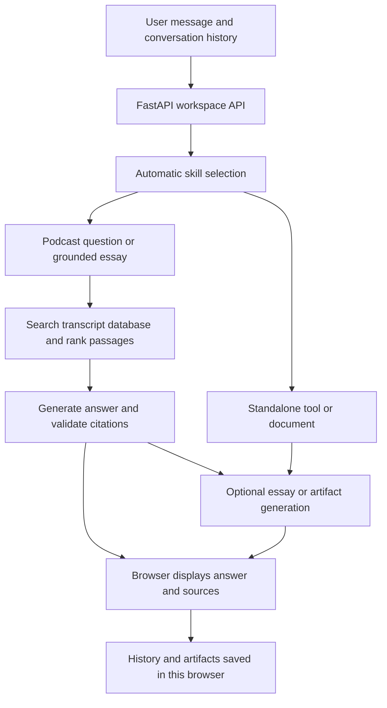

# Lenny Growth Assistant: project explanation and health report

**Reviewed:** 10 October 2026 (India time)  
**Code revision:** `0f4ed93`  
**Scope:** current local code, automated checks, live database, six live generation requests, and browser verification. Application source was not changed.

## Overall assessment

**This is a functioning AI prototype with a substantial retrieval system and a working interface. It is not yet a consistently reliable public product.**

The database is populated, both AI providers answer podcast questions, the interface passes its existing browser checks, and all **711 backend tests pass**. However, fresh testing found an OpenAI essay failure, an OpenAI reranking fallback, and a calculation error in a Llama-generated tool. Public access and deployment packaging also need attention before a wider release.

These findings distinguish a working application from correct output: returning a response or displaying a calculator does not prove that the response is complete or the calculation is correct.

## 1. What the project does

Lenny Growth Assistant turns Lenny’s Podcast transcripts into a conversational workspace for product managers, founders, and growth teams. It supports three kinds of requests:

| Capability | Example | What the user receives |
|---|---|---|
| Podcast Q&A | “What is the Sean Ellis test for product-market fit?” | An answer with expandable transcript sources. |
| Essay writing | “Write an essay about improving activation.” | A Markdown essay with citations, shown in an artifact panel. |
| Small tools and documents | “Build a growth calculator.” | An HTML tool, document, or code artifact that can be inspected and downloaded. |

The selected model chooses the appropriate skill automatically. Follow-up requests can revise an artifact or change tasks. Users choose between OpenAI and Llama 3.1 8B through OpenRouter.

This is retrieval-augmented generation (RAG): the application searches stored transcript passages and gives relevant evidence to a model before it writes an answer. It does not train a new model on the transcripts, and the podcast-answer path does not browse for current facts. Standalone tools can be generated without retrieving podcast evidence.

### How a request moves through the system

The frontend uses Vite and plain JavaScript. FastAPI handles requests; PostgreSQL/Supabase stores the knowledge base; pgvector supports semantic search. Retrieval combines meaning-based and keyword searches, reranking, a bounded evidence context, and optional searches for missing topics.

The OpenAI path uses the configured `gpt-6-luna` model and `text-embedding-3-small` embeddings. The OpenRouter path uses Llama 3.1 8B for writing, BGE-M3 embeddings, Voyage reranking, and Qwen helper models for parts of scope/review. Therefore, the Llama option is a multi-model pipeline, with several potential sources of latency and failure.

Conversation and artifact database models exist, but the active workspace saves them in browser local storage. Account-based persistence and synchronization are not connected to this flow.

## 2. What is working now

| Area | Evidence from this review | Status |
|---|---|---|
| Backend behavior | **711 tests passed**, one deprecation warning. | Verified by automated tests, including mocked provider/database cases. |
| Frontend compilation | Production build succeeded. | Working. |
| Backend liveness | `/health/live` returned 200. | Working. |
| Database readiness | `/health/ready` returned 200 with `database: ready`. | Live connection and expected migration revision verified. |
| Website serving | `/` returned HTML after the frontend build. | Working locally through the backend. |
| Knowledge storage | 303 episodes and 22,086 transcript chunks. | Verified with live, read-only queries. |
| Embedding storage | 22,086 OpenAI vectors and 22,086 OpenRouter vectors; 44,172 total. | Counts verified; this is not a fresh audit of every vector’s contents. |
| Provider selection and routing | Both providers completed live Q&A and tool generation; existing routing tests pass. | Working on sampled requests. |
| Browser interactions | Existing workspace and model-selector scripts passed. | History, citations, previews, downloads, retry, focus, and mobile layout checked. |
| Preview protections | Browser checks confirmed isolated HTML execution and Markdown sanitization. | Tested protections work; not a complete security assessment. |
| Generated OpenAI calculator | Correct results for both 10% and 10.5% monthly growth. | Verified in the actual artifact preview. |

The initial backend test run had five temporary-directory permission errors alongside 706 passes. A fresh project-local temporary directory resolved them: the complete rerun passed. The frontend build also needed execution outside the restricted sandbox. These were environment issues, not confirmed application defects.

### Fresh live generation results

Both providers received the same three requests, using automatic routing. One sequence ran per provider, with the two sequences running concurrently. Timing includes the application’s generation flow but excludes a separate browser-to-server network journey.

| Request | OpenAI | Llama / OpenRouter |
|---|---|---|
| Explain the Sean Ellis PMF test briefly, with sources | **200; 42.50 seconds.** Five sources, reported complete coverage. Reranking fell back. | **200; 34.72 seconds.** Five sources, reported complete coverage. More verbose than requested. |
| Write a 150-word activation essay using podcast ideas | **502; 51.71 seconds. No essay.** Evidence validation rejected the underlying answer. | **200; 65.80 seconds.** Markdown essay with three sources, partial coverage. Grounded-answer generation had fallen back after review rejection. |
| Build an interactive HTML growth calculator | **200; 13.61 seconds.** Calculator passed the sampled arithmetic checks. | **200; 3.29 seconds.** Calculator rendered, but failed the decimal-rate check below. |

Five of six requests returned HTTP 200. **That is a small smoke-test result, not an accuracy score or reliability estimate.** I checked the Q&A claims against their returned passages; the core question, response options, 40% benchmark, and retention caveat had supporting evidence. This was a limited spot check, not a complete independent factual audit.

## 3. What failed or is degraded

### A. OpenAI essay generation failed on a normal request

The request was: “Write a 150-word essay about improving user activation using ideas from the podcast.”

The API returned `502` with: “OpenAI answer was incomplete, refused, or failed evidence validation.” This happened before an essay could be delivered. The error groups several validation conditions, so this run does not establish exactly which condition failed. It does establish that an ordinary essay request can fail despite the passing test suite.

**Recommended action:** preserve safe internal reason codes for these failures, add this prompt to live regression checks, and improve bounded recovery without publishing unvalidated drafts.

### B. The generated Llama calculator mishandles decimal percentages

For **1,000 starting users, 10.5% monthly growth, and two months**, the expected result is **1,221.03**. The generated tool displayed **1,210.00** because it uses `parseInt` for the growth percentage, silently changing 10.5% to 10%.

Both generated calculators returned 1,210 for the whole-number 10% test. Only the OpenAI calculator passed the decimal case. This is a defect in this particular generated artifact, not proof that every Llama-generated tool fails.

The backend’s artifact checks mainly detect preview incompatibilities such as external scripts, dynamic evaluation, or browser-storage usage. They do not establish arithmetic correctness.

**Recommended action:** require representative behavior checks for generated tools, including decimals and invalid inputs. Add numerical requirements to generation instructions, but do not treat prompting alone as verification.

### C. OpenAI reranking degraded to its fallback

During the live PMF question, the reranker returned duplicate passage IDs twice. The application correctly rejected the invalid rankings and retained the original candidate order. An answer still arrived, but the intended evidence-ordering step did not succeed for that request.

**Recommended action:** track rerank success and fallback rates, retain this case in regression evaluation, and investigate the duplicate-ID output. A successful final response currently hides this degradation from ordinary success metrics.

### D. Llama answer quality and essay grounding remain uneven

The activation request triggered three grounding-review rejections and a fallback before the essay was produced with partial coverage. A readable essay is useful, but it is weaker evidence of successful synthesis than a fully reviewed answer.

The saved 8 October resilience report similarly describes a seven-case run with four fallbacks. Those historical results support the existence of this limitation, but they are not a fresh measurement of today’s code.

**Recommended action:** distinguish verified answers, excerpt fallbacks, partial answers, and unavailable responses in evaluation and monitoring. Track factual completeness separately from citation validity.

## 4. Missing features and release risks

| Gap | Practical consequence | Priority |
|---|---|---|
| Public workspace chat has no application-level authentication, rate limiting, or per-user usage quota. | If exposed publicly without external controls, other people can trigger paid model calls. Production tests explicitly permit remote workspace requests. The raw RAG endpoints are protected separately. | Before public release. |
| No root `.dockerignore`; Docker copies the entire `backend/` directory. | A build from this local directory can copy the present `.env`, virtual environment, and local data into the build/image. `.gitignore` does not exclude them from a local Docker build. No deployed secret leak was demonstrated. | Before building or distributing an image from a populated local checkout. |
| Browser-only conversation and artifact storage. | No account recovery or cross-device synchronization; clearing browser data removes saved work. | Required if durable user workspaces are a product promise. |
| Stop aborts browser waiting, without a dedicated server cancellation workflow. | An already-started model request may continue and incur usage. | Improve cost and request management. |
| No response streaming in the current workspace route. | Users wait for the complete response; the sampled Q&A/essay requests took roughly 35–66 seconds. | Improve perceived speed after correctness. |
| Readiness checks database/schema only. | A green health check does not establish working provider credentials, indexed content, or successful generation. | Add separate service diagnostics and monitoring. |
| No deployment or load test in this review. | Concurrent-user capacity and the actual Railway configuration remain unverified. | Verify before a public launch. |

HTML previews intentionally block external connections and assets. Python and other non-HTML code are displayed rather than executed. These are current scope boundaries, not broken features.

## 5. Setup documentation needs correction

The main README’s ingestion instructions are incomplete:

1. It says `python -m app.ingestion` generates embeddings. The command’s implementation explicitly imports transcripts **without embedding calls**.
2. The quick-start flow omits applying database migrations before using a fresh database.
3. The transcript source defaults to a machine-specific Windows path and requires an exact pinned checksum. A newly downloaded ZIP is not guaranteed to be the approved archive. The importer supports `--archive` for relocation of a matching ZIP.
4. The frontend README says the API remains local-development-only, but the workspace chat route is deliberately public in production. Only the lower-level raw RAG routes enforce that restriction.

The more detailed backend evaluation guide documents migration and embedding commands. The main README should integrate a single complete setup sequence, including embedding the selected provider’s corpus and checking readiness/coverage. The current database is already populated, which masks these onboarding problems on this machine.

## 6. How much confidence to place in the existing evaluations

The repository contains extensive saved evaluations, which is a strength. One older full-corpus report records 303/303 indexed files, 81.5% expected-evidence hits in the top 20, and model-judged end-to-end groundedness of 87.5% over 40 questions. These figures belong to that saved configuration and sample; they do not establish current universal accuracy.

Some source questions are synthetic, and some answer reviews use related model families. The current implementation has also evolved beyond earlier snapshots. The fresh review therefore uses those reports as historical context, while treating today’s checks and observed failures as the evidence for current status.

## 7. Recommended order of work

1. **Before wider access:** protect paid chat usage and exclude local secrets/data from Docker packaging.
2. **Fix observable reliability gaps:** OpenAI essay failure, duplicate-ID reranking, and generated-tool numerical correctness.
3. **Make degraded behavior measurable:** record safe failure reasons, fallback rates, request durations, and provider usage. Keep user-facing explanations clear.
4. **Make fresh setup reproducible:** migrations, approved archive, embeddings for each enabled provider, then a small live smoke suite.
5. **Complete the intended product features:** durable accounts/history if needed, cancellation, streaming, and deployment/load validation.

The strongest existing pieces are the populated knowledge base, automated backend coverage, provider separation, and usable artifact interface. The next investment should be consistent output quality and safe operation of public usage.

## Evidence and important implementation files

- [Six fresh live responses and generated artifacts](<C:/Users/91990/OneDrive/Desktop/Lenny-Growth-Assistant/docs/project-audit-live-2026-10-10.json>)
- [Browser arithmetic checks](<C:/Users/91990/OneDrive/Desktop/Lenny-Growth-Assistant/docs/project-audit-calculators-2026-10-10.json>)
- [Workspace request handling](<C:/Users/91990/OneDrive/Desktop/Lenny-Growth-Assistant/backend/app/api/routes/workspace.py>)
- [Frontend behavior and local history](<C:/Users/91990/OneDrive/Desktop/Lenny-Growth-Assistant/frontend/src/main.js>)
- [Application startup and website serving](<C:/Users/91990/OneDrive/Desktop/Lenny-Growth-Assistant/backend/app/main.py>)
- [Docker packaging](<C:/Users/91990/OneDrive/Desktop/Lenny-Growth-Assistant/Dockerfile>)
- [Transcript import command](<C:/Users/91990/OneDrive/Desktop/Lenny-Growth-Assistant/backend/app/ingestion/__main__.py>)
- [Embedding/setup guide](<C:/Users/91990/OneDrive/Desktop/Lenny-Growth-Assistant/backend/EVALUATION.md>)
- [Historical full-corpus evaluation](<C:/Users/91990/OneDrive/Desktop/Lenny-Growth-Assistant/backend/evals/results/full_evaluation.md>)
- [Historical Llama resilience report](<C:/Users/91990/OneDrive/Desktop/Lenny-Growth-Assistant/backend/evals/results/llama_rag_resilience_report_2026-10-08.md>)

**Review limits:** No production deployment, security penetration test, dependency vulnerability scan, full corpus reindex, load test, or broad new accuracy benchmark was performed. The six live cases are deliberately small. No application fixes, database mutations, or deployment changes were made.
